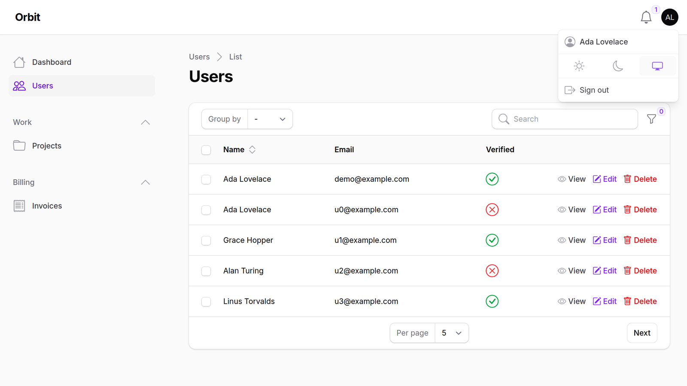

<p class="filament-hidden" align="center">
    
</p>

# Filament Bootstrap Icons

A [Bootstrap Icons](https://icons.getbootstrap.com) set for [Filament Icons](https://github.com/filafly/filament-icons). Register one plugin and every icon in Filament's own UI (sidebar, tables, forms, actions, notifications, the rich editor toolbar, multi-factor auth and the rest) switches to Bootstrap Icons, in regular or fill style. All 2,078 Bootstrap icons are also available as an enum for your own resources.

Works with Filament 4 and 5.

More about this package on FilaFly: [Bootstrap Icons for Filament on FilaFly](https://filafly.com/plugins/bootstrap-icons?utm_source=github&utm_medium=readme&utm_campaign=bootstrap-icons).

## Installation

You can install the package via composer:

```bash
composer require filafly/filament-bootstrap-icons
```

Not sure which Laravel and PHP versions your Filament version needs? See the [Filament version compatibility guide](https://filafly.com/guides/filament-version-compatibility).

After the package is installed, you must register the plugin in your Filament Panel provider:

```php
use Filafly\Icons\Bootstrap\BootstrapIcons;

public function panel(Panel $panel): Panel
{
    return $panel
        ->plugin(BootstrapIcons::make());
}
```

That's it. Every Filament icon alias (all 223 in Filament 5) is mapped to a Bootstrap icon.

## Setting the global icon style

Bootstrap Icons come in two styles:

- Regular (default)
- Fill

```php
BootstrapIcons::make()->regular(); // (default)
BootstrapIcons::make()->fill();
```

Only icons that Bootstrap draws in both styles switch. Chevrons, the close cross, the search glass and the editor toolbar icons, for example, have no fill version and stay the same.

## Setting style for a subset of icons

If you need some icons in a different style, you can use either icon aliases or icon enum cases.

### Using icon aliases
Use the `overrideStyleForAlias` method with a [Filament Icon Alias](https://filamentphp.com/docs/styling/icons#available-icon-aliases). It takes a single alias or an array of aliases.

```php
use Filafly\Icons\Bootstrap\BootstrapIcons;
use Filafly\Icons\Bootstrap\Enums\BootstrapStyle;
use Filament\Tables\View\TablesIconAlias;
use Filament\Actions\View\ActionsIconAlias;

// Override a single alias
BootstrapIcons::make()->overrideStyleForAlias(TablesIconAlias::ACTIONS_FILTER, BootstrapStyle::Fill);

// Override several aliases at once
BootstrapIcons::make()->overrideStyleForAlias([
    TablesIconAlias::ACTIONS_FILTER,
    ActionsIconAlias::DELETE_ACTION,
], BootstrapStyle::Fill);
```

### Using icon enum cases
Use the `overrideStyleForIcon` method with Bootstrap enum case(s). Like the alias method, it takes a single case or an array.

```php
use Filafly\Icons\Bootstrap\BootstrapIcons;
use Filafly\Icons\Bootstrap\Enums\Bootstrap;
use Filafly\Icons\Bootstrap\Enums\BootstrapStyle;

// Override a single icon
BootstrapIcons::make()->overrideStyleForIcon(Bootstrap::Trash, BootstrapStyle::Fill);

// Override several icons at once
BootstrapIcons::make()->overrideStyleForIcon([
    Bootstrap::Trash,
    Bootstrap::Funnel,
], BootstrapStyle::Fill);
```

## Specifying exact icons to use

You can also specify exactly which icon you would like to use in given situations. This can be done via icon aliases or icon enum cases.

### Override icon aliases

Use `overrideAlias()` to change which icon is used for specific Filament icon aliases:

```php
use Filafly\Icons\Bootstrap\BootstrapIcons;
use Filafly\Icons\Bootstrap\Enums\Bootstrap;
use Filament\View\PanelsIconAlias;
use Filament\Tables\View\TablesIconAlias;

BootstrapIcons::make()
    ->overrideAlias(PanelsIconAlias::SIDEBAR_EXPAND_BUTTON, Bootstrap::ChevronDoubleRight)
    ->overrideAlias(TablesIconAlias::ACTIONS_FILTER, Bootstrap::Filter);
```

Or use `overrideAliases()` to override multiple aliases at once by passing an array:

```php
BootstrapIcons::make()
    ->overrideAliases([
        PanelsIconAlias::SIDEBAR_EXPAND_BUTTON => Bootstrap::ChevronDoubleRight,
        TablesIconAlias::ACTIONS_FILTER => Bootstrap::Filter,
    ]);
```

### Override individual icons

Use `overrideIcon()` to replace a Bootstrap icon everywhere this pack uses it:

```php
BootstrapIcons::make()
    ->overrideIcon(Bootstrap::Trash, Bootstrap::Trash3)
    ->overrideIcon(Bootstrap::PencilSquare, Bootstrap::Pencil);
```

Or use `overrideIcons()` to override multiple icons at once by passing an array:

```php
BootstrapIcons::make()
    ->overrideIcons([
        Bootstrap::Trash->value => Bootstrap::Trash3,
        Bootstrap::PencilSquare->value => Bootstrap::Pencil,
    ]);
```
> PHP arrays do not support enums as keys so `->value` is necessary if you want to reference the enum

Exact overrides win over styles, so pick the regular or fill case you want.

## Icon enum

All Bootstrap icons are available through an enum providing convenient usage throughout Filament. For more information, check the [Filament docs](https://filamentphp.com/docs/styling/icons).

```php
use Filament\Forms\Components\Toggle;
use Filafly\Icons\Bootstrap\Enums\Bootstrap;

Toggle::make('is_starred')
    ->onIcon(Bootstrap::StarFill)
```

The icons come from [davidhsianturi/blade-bootstrap-icons](https://github.com/davidhsianturi/blade-bootstrap-icons), so `<x-bi-star />` and `@svg('bi-star')` work in your own Blade views too.

## Testing

```bash
composer test
```

The suite checks that every icon alias in the installed Filament version is mapped, that every enum case has an SVG, and that `fill()` switches every icon that has a fill version.

## From FilaFly

FilaFly also makes premium themes for Filament panels: Lucent, Prizm, Cypher and Citrus. [Browse the themes](https://filafly.com/themes?utm_source=github&utm_medium=readme&utm_campaign=bootstrap-icons).

## License

The MIT License (MIT). Please see [License](LICENSE.md) for more information. This package contains no icon files: the icons are installed by davidhsianturi/blade-bootstrap-icons.

Bootstrap Icons are © The Bootstrap Authors under the [MIT License](https://github.com/twbs/icons/blob/main/LICENSE).
